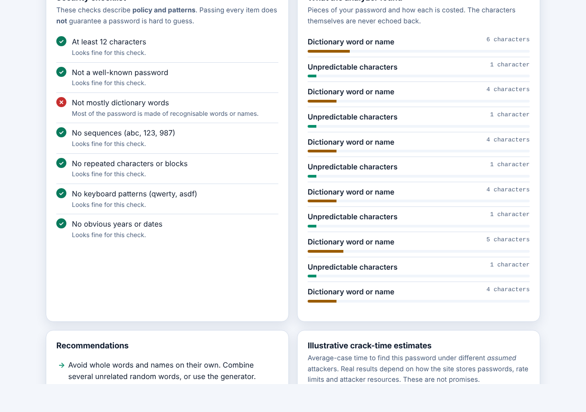
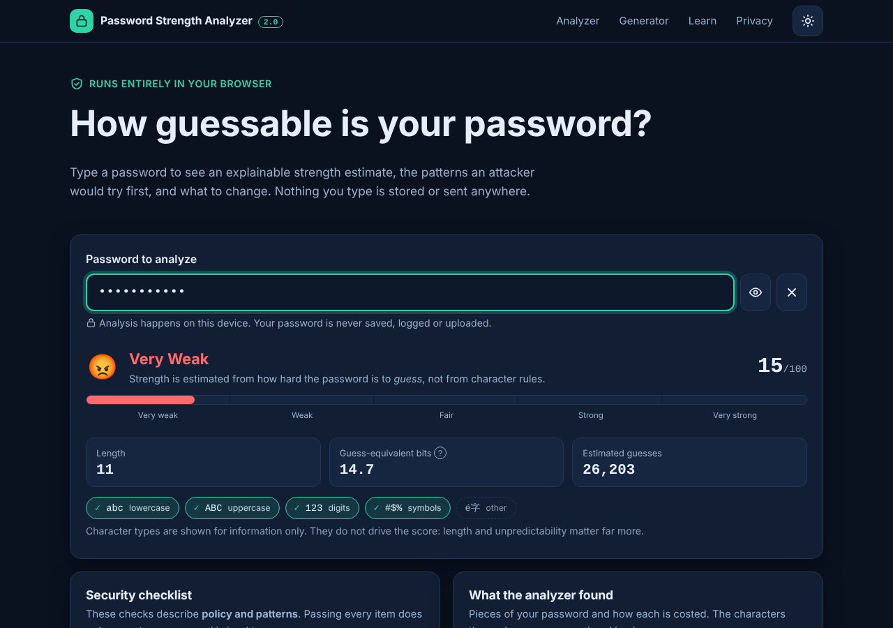
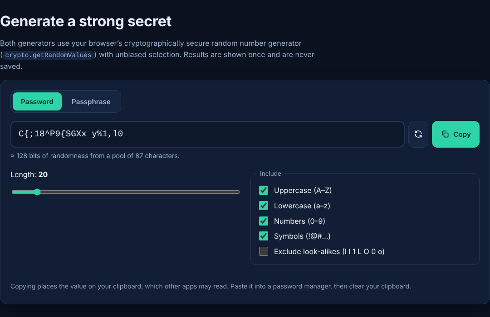
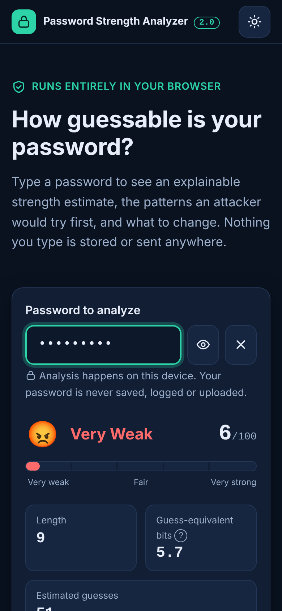

# 🔐 Password Strength Analyzer 2.0 — UI Showcase

A privacy-first, browser-based password strength analyzer and secure password/passphrase generator, designed and developed by **Ratnesh Pathak**.

This project is a modernized version of my earlier Password Visualizer. Version 2.0 introduces explainable password-strength estimates, secure random generation, an optional privacy-conscious breach check, and a responsive interface.

This public repository contains project documentation and UI screenshots. The application source code remains in the original private repository.

## 🖥️ Screenshots

### Analyzer — Light Theme

### Analyzer — Dark Theme

### Generator — Dark Theme

### Mobile Interface

## ✨ Key Features

- Real-time password-strength score and five strength levels
- Explainable feedback about predictable patterns
- Secure password and passphrase generators
- Cryptographically secure randomness using the browser's Web Crypto API
- Optional breached-password check using the Have I Been Pwned range API
- Light and dark themes
- Responsive layout, keyboard support, and reduced-motion support
- Educational guidance on password managers, passkeys, MFA, and password reuse

## 🔒 Privacy and Security

Password analysis runs locally in the browser. The application is designed not to store or log entered passwords.

The optional breach check requires explicit consent and uses a k-anonymity approach. Only the first five characters of the password's SHA-1 hash are sent to the breach-check service.

Strength scores and estimated crack times are illustrative estimates, not guarantees of password security.

**Never enter a real password into a public demo or share screenshots containing actual passwords.**

## 🛠️ Technology Stack

- HTML5
- CSS3
- Vanilla JavaScript
- Web Crypto API
- Node.js built-in test runner

## 🧪 Testing

The original project includes automated tests for password analysis, generation, breach-check behavior, and privacy-related safeguards.

## 📄 License

No license has been selected for this project. All rights are reserved by the author unless a license is added.

## 👨‍💻 Developer

**Ratnesh Pathak**

GitHub: [@RatneshPathak](https://github.com/RatneshPathak)

---

*An independent project created for learning, development, and portfolio demonstration.*